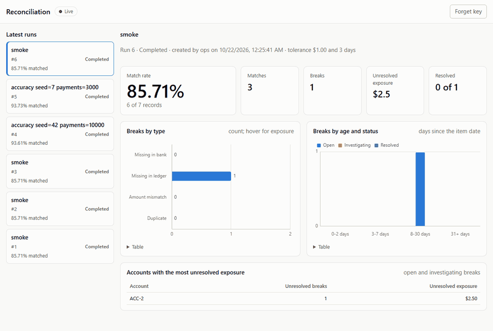
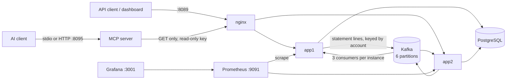

# Transaction Audit & Matching Service

Compares a company's ledger against its bank statement, finds every mismatch, lets people resolve each one with a
full audit trail, and gives an AI assistant read-only access so you can ask about the mismatches in plain English.

Java 21 · Spring Boot 4.1 · PostgreSQL 18 · Kafka 4.3 (KRaft) · nginx · Prometheus · Grafana · MCP Java SDK 2.1 ·
Testcontainers · GitHub Actions. Everything runs locally with Docker Compose; nothing is deployed, and no AI API key
is needed.



## Results

Every number here is copied from a file in [`results/`](results/README.md), which also says how to reproduce it.

**Accuracy** on 10,000 synthetic payments (seed 42) over 12 accounts, with known breaks injected: 9,982 ledger
records against 9,871 statement lines ([`results/accuracy/latest.md`](results/accuracy/latest.md)).

| Metric | Value |
|---|---|
| Match precision | 99.10% (9,208 of 9,292 matches made pair the right two records) |
| Match recall | 98.09% (9,208 of 9,387 true matches found) |
| Break precision | 73.14% (806 of 1,102 reported breaks have the right type and records) |
| Break recall | 89.86% (806 of 897 injected breaks found exactly) |

The generator and the matcher are deterministic, so CI re-runs this check and fails if any count changes.

**Throughput** for 100,941 ledger records against 100,053 statement lines, through nginx to two instances, on a
laptop ([`results/benchmark/latest.md`](results/benchmark/latest.md)):

| Metric | Value |
|---|---|
| Ledger upload (validate + store) | 2.7 s |
| Statement upload (validate + record + queue every line on Kafka) | 1.4 s |
| Then until the run is COMPLETED | 45.3 s |
| Total, first byte of the ledger to COMPLETED | 49.3 s |
| Statement throughput (upload + matching) | 2,144 lines/s |
| Match precision / recall at this size | 97.46% / 97.54% |

Each app instance stayed inside its 768 MB container (peak 667 MiB; the details file lists every container).

## What it does

- **Runs.** A run takes one ledger file and one bank statement file (CSV or JSON). Each row is validated; rejected
  rows come back in a rejection report with the reason, and accepted rows are stored. Uploading the same file again
  is a no-op (same SHA-256); a different file is a 409.
- **Matching, in three rules.** (a) *Exact*: same account, reference and amount, run on each statement line as it
  arrives. (b) *Tolerance*: amount within ±$1.00 and dates within ±3 days (per-run settings), references preferred.
  (c) *Normalized reference*: `INV-000003` and `inv 3` are the same reference, amount within tolerance, any date.
  The fuzzy rules run once the whole statement is in, so they can never take a record a later line matches exactly.
- **Breaks.** Whatever is left is a break: `MISSING_IN_BANK`, `MISSING_IN_LEDGER`, `AMOUNT_MISMATCH` or
  `DUPLICATE`, with its exposure, its age (0–2, 3–7, 8–30, 31+ days) and an explanation of every rule that was
  tried and why it did not match.
- **Workflow and audit trail.** People move a break from `OPEN` to `INVESTIGATING` to `RESOLVED` (with a resolution
  code and a note), reassign it, reopen it, and add notes. PostgreSQL triggers write every change into an
  append-only trail with who made it and the request's correlation id, and refuse any change that names nobody,
  even one made by hand in `psql`. Two people acting on the same break cannot overwrite each other: the second gets
  a 409.
- **Two instances behind nginx.** Statement lines go through Kafka, partitioned by account. Lines of one account are
  processed in file order even after a redelivery, a run completes exactly once, and a killed instance's work moves
  to the other one within seconds.
- **Dashboard.** A live page (vanilla JS, Chart.js, Server-Sent Events): the latest runs with progress while they
  match, match rate, breaks by type, by age and workflow status, and the accounts with the most unresolved
  exposure.
- **Metrics.** Prometheus scrapes both instances; Grafana comes provisioned with a dashboard (lines per second,
  matches by rule, Kafka lag, backlog, API latency, JVM heap).
- **MCP server.** Seven read-only tools for an AI client (list runs, break down a run, list and explain breaks, show
  a break's history, list matches), over stdio or Streamable HTTP. See [MCP_GUIDE.md](MCP_GUIDE.md).

## Architecture



A statement upload is validated and recorded, then every accepted line is published to Kafka keyed by account
before the upload answers 201. Whichever instance owns the account's partition stores the lines and runs the exact
rule on them. The transaction that stores a run's last line runs the end-of-run step (rules b and c, then breaks)
and completes the run. [DESIGN.md](DESIGN.md) explains each choice, with the alternatives considered.

## Run it

You need Docker (the full profile's memory limits add up to 4.8 GB; during the benchmark its containers peaked at
2.9 GB together) and, to build and test outside Docker, JDK 21.

```bash
cp .env.example .env                                     # local-only demo keys; change them if you like
docker compose --profile full up -d --build --wait       # Postgres, Kafka, 2 apps, nginx, MCP, Prometheus, Grafana
scripts/smoke.sh                                         # end-to-end check through nginx
```

| What | Where |
|---|---|
| API and dashboard (enter `READONLY_API_KEY` or `OPERATOR_API_KEY` from `.env`) | http://localhost:8089 |
| Grafana (anonymous view; `admin` / `GRAFANA_ADMIN_PASSWORD` to edit) | http://localhost:3001 |
| Prometheus | http://localhost:9091 |
| Kafka UI (read-only) | http://localhost:8091 |
| MCP server (Streamable HTTP, bearer `MCP_HTTP_TOKEN`) | http://localhost:8095/mcp |

Every port is bound to 127.0.0.1 only. `--profile lite` runs one app instance and skips Prometheus and Grafana;
with no profile only Postgres and Kafka start, for running the service from an IDE
(`./mvnw -pl service spring-boot:run`).

Load realistic data with the generator (it creates a run, uploads both files, waits, and scores the result):

```bash
set -a; source .env; set +a
./mvnw -q -pl generator package -DskipTests
java -jar generator/target/generator-0.0.1-SNAPSHOT-cli.jar accuracy --payments 10000 --results /tmp/accuracy
```

## The API in one session

Every request needs an `X-API-Key`. Operator keys may do everything; read-only keys may only read. Errors are
RFC 9457 problem details, and every response carries an `X-Correlation-Id`.

```bash
KEY="X-API-Key: $OPERATOR_API_KEY"
curl -s -H "$KEY" -H 'Content-Type: application/json' -d '{"label":"October"}' localhost:8089/v1/runs   # -> id 1
curl -s -H "$KEY" -H 'Content-Type: text/csv' --data-binary @ledger.csv    localhost:8089/v1/runs/1/ledger
curl -s -H "$KEY" -H 'Content-Type: text/csv' --data-binary @statement.csv localhost:8089/v1/runs/1/statement
curl -s -H "$KEY" localhost:8089/v1/runs/1                       # status, counts, match rate
curl -s -H "$KEY" 'localhost:8089/v1/breaks?runId=1&status=OPEN'  # the worklist
curl -s -H "$KEY" localhost:8089/v1/breaks/7                     # one break and why it did not match
curl -s -H "$KEY" -H 'Content-Type: application/json' -d '{"version":0,"assignee":"alice"}' \
     localhost:8089/v1/breaks/7/investigate
curl -s -H "$KEY" -H 'Content-Type: application/json' \
     -d '{"version":1,"resolution":"BANK_FEE","note":"Wire fee, confirmed with the bank."}' \
     localhost:8089/v1/breaks/7/resolve
curl -s -H "$KEY" localhost:8089/v1/breaks/7/history             # who did what, oldest first
```

| Method and path | What it does |
|---|---|
| `POST /v1/runs`, `GET /v1/runs`, `GET /v1/runs/{id}` | Create a run (optional `amountToleranceCents`, `dateWindowDays`); list; read with counts |
| `POST /v1/runs/{id}/ledger`, `POST /v1/runs/{id}/statement` | Upload a file as `text/csv` or `application/json`; answers with the rejection report |
| `GET /v1/runs/{id}/imports` | The two imports' reports again |
| `GET /v1/runs/{id}/matches` | Matches with the rule that made each one (paged by `afterId`) |
| `GET /v1/runs/{id}/breakdown` | Breaks by type, status, age and account: what the dashboard charts |
| `GET /v1/breaks` | Filter by `runId`, `type`, `status`, `assignee`, `accountId`, `minExposureCents`, `minAgeDays`; paged by `afterId` |
| `GET /v1/breaks/{id}`, `GET /v1/breaks/{id}/history` | One break with its explanation; its audit trail |
| `POST /v1/breaks/{id}/investigate`, `/resolve`, `/reopen`, `/assign`, `/notes` | The workflow; every change but a note sends the `version` it read |
| `GET /v1/stream` | Server-Sent Events for the dashboard |

## Tests

```bash
./mvnw verify      # unit tests, then integration tests on Testcontainers (needs Docker)
```

The integration tests run against real PostgreSQL, Kafka and nginx containers, never mocks. Among them:

- `ReconciliationIT` produces every break type through the public API; `AccuracyResultsIT` re-runs the 10,000-payment
  accuracy check and requires the recorded counts.
- `SameFileConcurrencyIT` sends the same file through both instances at once; `InstanceFailoverIT` and
  `UploadFailoverIT` SIGKILL an instance mid-transaction and mid-upload, and the run still completes correctly.
- `BreakWorkflowIT` fires 8 simultaneous resolves at one break (exactly one wins); `AuditTrailIT` makes changes
  straight in PostgreSQL and checks the triggers record or refuse each one.
- `DashboardIT` reads the event stream; `MetricsIT` checks every metric the Grafana dashboard charts exists.
- `McpHttpIT` calls every MCP tool through a real MCP client and checks that no table changed; `McpStdioIT` runs
  the packaged jar over stdio.

CI (GitHub Actions) runs all of that, starts the full compose stack and runs `scripts/smoke.sh` against it, scans the
whole git history with gitleaks, and checks commit messages.

## Repository

| Path | What is there |
|---|---|
| `service/` | The matching service: ingestion, matching, breaks, workflow, dashboard, metrics |
| `mcp-server/` | The read-only MCP server |
| `generator/` | Synthetic ledgers and statements with known breaks, the scorer, the accuracy and throughput runners |
| `nginx/`, `observability/`, `compose.yaml`, `Dockerfile` | The local deployment |
| `scripts/` | `smoke.sh`, `accuracy.sh`, `benchmark.sh`, `new-api-key.sh`, `export-payments-ledger.sh` |
| `results/` | Recorded accuracy and throughput runs, with the commit each ran on |
| [PLAN.md](PLAN.md), [DESIGN.md](DESIGN.md), [MCP_GUIDE.md](MCP_GUIDE.md), [AI-ASSISTANCE.md](AI-ASSISTANCE.md) | Plan and decisions, design, MCP setup, how AI was used |

`scripts/export-payments-ledger.sh` turns the ledger of the companion
[Payments Ledger Service](https://github.com/Sanskar121543/payments-ledger-service) into this service's ledger CSV,
and `generator statement-for` plays the bank for it, so the two projects can be reconciled against each other.

## Limits

- Local only: API keys, not user accounts; every port on loopback; demo keys in `.env.example` are public.
- One currency (USD) and one ledger file and one statement file per run.
- The accuracy numbers are on synthetic data with the break types the generator injects; real bank data has
  formats and failure modes it does not model.
